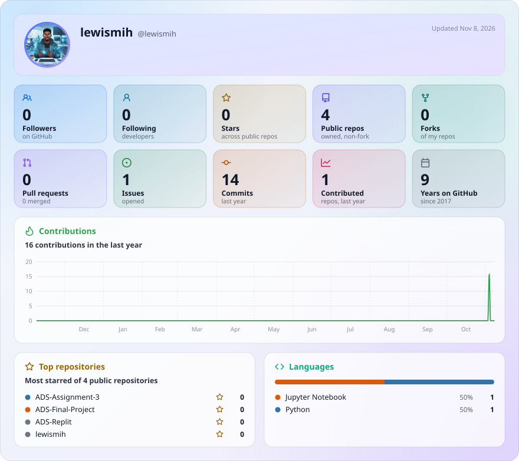

# 👋 Hi, I'm Lewis Kabocho

### Cybersecurity Analyst | Systems Administrator | Automation Enthusiast | Graphic Design Hobbyist

I work across cybersecurity, IT infrastructure and workflow automation, with a practical interest in building secure, reliable systems and making technology work smarter. I also enjoy graphic design and visual communication.

**Secure. Administer. Automate. Create.**

---

## 🔧 Tech & Interests

- **Cybersecurity:** security analysis, web and network security, vulnerability assessment, SIEM and OSINT.
- **System administration:** Linux, Windows, networking, virtualization, endpoint and infrastructure support.
- **Automation:** n8n, APIs, webhooks, Python and AI-assisted workflows.
- **Creative:** graphic design, digital graphics, branding and visual communication.

**Tools:** Burp Suite · Wazuh · Wireshark · Nmap · Nuclei · Acunetix · OpenVAS · WPScan · Cloudflare · Shodan · Censys · Linux · Ubuntu · VMware · n8n · Python · Git

---

## 📊 GitHub at a Glance

<!-- GlanceCard is generated by GitHub Actions and stored in this repository. -->
<picture>
  <source media="(prefers-color-scheme: dark)" srcset="glancecard/profile-dark.svg">
  
</picture>

---

## 🏆 Achievements

<!-- Self-hosted via GitHub Metrics (lowlighter/metrics) using GitHub Actions.
     SVG is generated and committed to this repository. -->

---

## 📫 Connect

- 💼 LinkedIn: [Connect with me](linkedin.com/in/lewis-kabocho/)
- 🐙 GitHub: [Explore my repositories](https://github.com/lewismih)

---

*Stay curious. Think critically. Build practically.*
